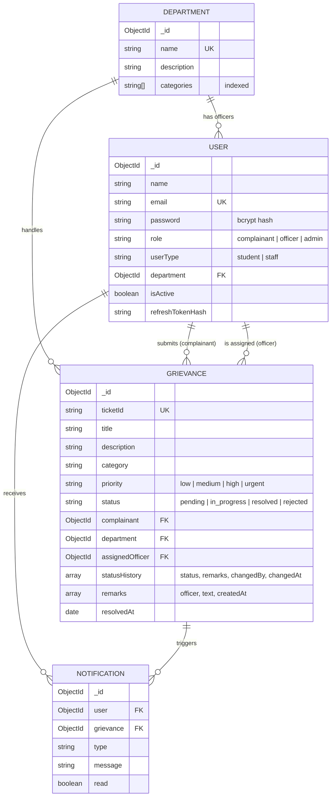

# CampusVoice – ER Diagram

## Indexes
| Collection | Index | Purpose |
|---|---|---|
| User | `email` (unique), `{role, department}` | login, officer lookup |
| Department | `name` (unique), `categories` | auto-assignment by category |
| Grievance | `ticketId` (unique), `{complainant, createdAt}`, `{assignedOfficer, status}`, `{department, status}`, text(`title`,`description`) | listing, workload, reports, search |
| Notification | `{user, read, createdAt}` | unread counts |
